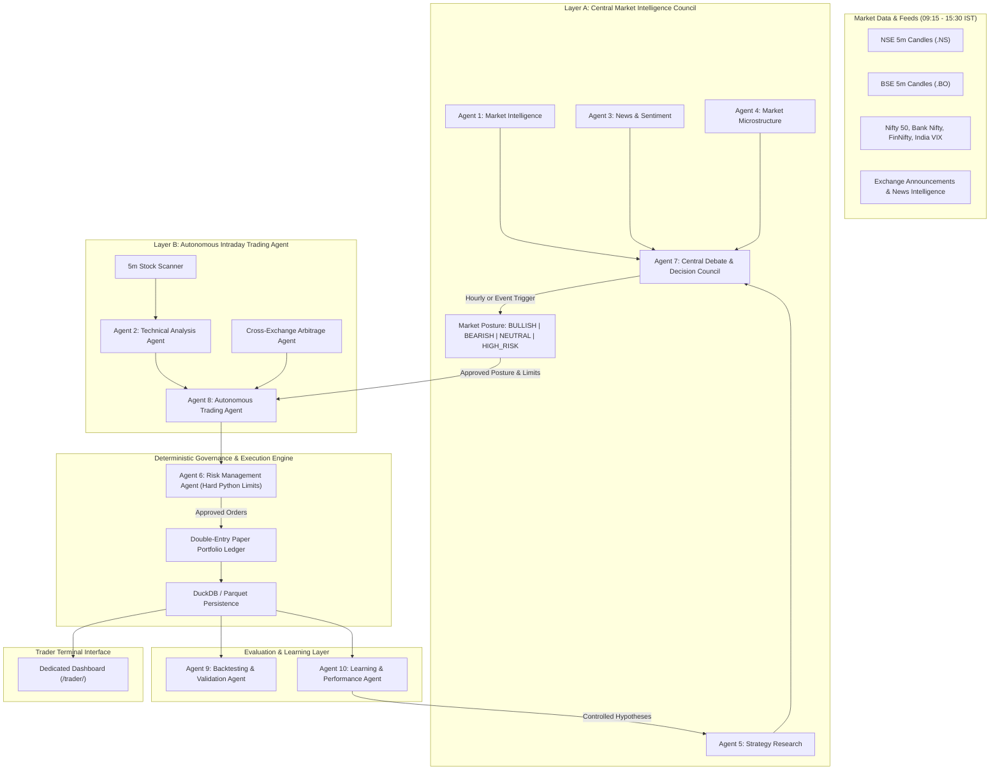

# Architecture Specification: AI Multi-Agent Intraday Trading Platform

**Repository**: `rammsec/indian-stock-ai-agent`  
**Branch**: `feature/personal-ai-trading-desk`  
**Execution Horizon**: 5-Minute Intraday Candles (NSE & BSE)  
**Execution Mode**: Historical Simulation & Zero-Capital Paper Trading Only  
**AI Framework**: Hybrid Deterministic Python + Google Gemini Multi-Tier Routing  

---

## 1. System Overview & Core Philosophy

The platform decouples market research, directional bias, and intraday execution into a **Two-Tier Intelligence Architecture**:



---

## 2. Intelligence Layers

### Layer A: Central Market Intelligence Council
The Council evaluates macro indices, market breadth, India VIX, FII/DII institutional flows, corporate filings, and global developments. It produces a market-wide posture instruction:
1. **BUY / BULLISH**: Risk appetite normal; long setups favored in leading sectors.
2. **SELL / BEARISH**: Capital preservation mode; new longs blocked, vulnerability trailing exits tightened, selective shorting only if explicitly enabled.
3. **NEUTRAL**: Sideways market; strict mean-reversion setups only with reduced position sizes.
4. **HOLD / HIGH RISK**: Volatility spike (VIX surge, budget/RBI policy announcements, binary news events); trading frozen or positions de-risked.

**Operating Cadence**: Evaluates at pre-market (08:45 IST), session open (09:15 IST), hourly intervals (10:15, 11:15, 12:15, 13:15, 14:15 IST), and immediately upon asynchronous **material event triggers** (e.g., sudden index breakdown > 1%, breaking news).

### Layer B: Autonomous Intraday Trading Agent
Monitors completed 5-minute candles in real time. It operates autonomously within the constraints and posture set by Layer A:
- Scans candidate stocks from the liquid NSE/BSE universe.
- Computes deterministic indicators (EMA 9/21/50, VWAP, RSI-14, MACD, ATR, volume spikes).
- Identifies entry opportunities, stop-losses, and profit targets.
- Submits simulated orders to the deterministic Risk Engine.
- Does **not** poll the Central Council on every 5-minute candle, avoiding token waste.

---

## 3. Communication & Data Protocol

All inter-agent communication uses strictly typed, validated Pydantic v2 data models with `extra='forbid'` and immutable SHA-256 provenance hashes. Agents communicate through structured JSON payloads, never free-form conversational chat.

```json
{
  "message_id": "msg_20261121_103000_ta_001",
  "agent_id": "technical_analysis_agent",
  "symbol": "RELIANCE",
  "exchange": "NSE",
  "isin": "INE002A01018",
  "timeframe": "5m",
  "timestamp": "2026-11-21T10:30:00+05:30",
  "signal": "BULLISH",
  "confidence": 0.78,
  "evidence": [
    "Price 1285.50 > VWAP 1279.20",
    "EMA 9 (1282.10) > EMA 21 (1278.40)",
    "Volume 1.8x 20-bar SMA",
    "RSI-14 at 58.4 (bullish momentum zone)"
  ],
  "risks": [
    "Intraday resistance at 1292.00 (R1 pivot)"
  ],
  "recommended_action": "ENTER_LONG",
  "setup_details": {
    "entry_price": 1285.50,
    "stop_loss": 1277.00,
    "target": 1302.50,
    "risk_reward_ratio": 2.0
  }
}
```

---

## 4. Deterministic Risk Controls (Hard Veto Gate)

AI agents provide opinions; the **deterministic Python Risk Engine** holds absolute veto power:
- **Maximum Risk Per Trade**: Maximum 1.0% of portfolio equity risked.
- **Maximum Position Sizing**: Capped at 10% - 20% of total capital per stock.
- **Maximum Portfolio Exposure**: Capped at 80% total capital invested.
- **Maximum Daily Loss Limit**: Trading halts for the day if portfolio equity drops 2.5% from day open.
- **Maximum Drawdown**: Circuit breaker triggers simulated risk reduction if drawdown reaches 5.0%.
- **Intraday Square-Off**: Strict automated exit of all intraday positions at 15:15 IST (no overnight carry).
- **Execution Friction Deduction**: All trade decisions subtract statutory Indian transaction taxes (STT, Stamp Duty, GST, Exchange Fees, SEBI fees) and dynamic slippage before calculating net expectancy.

---

## 5. Technology Stack Summary

| Layer | Selected Technology | Purpose |
| :--- | :--- | :--- |
| **Language** | Python 3.11+ | Type-annotated, fast execution |
| **Package Manager**| `uv` | Ultra-fast virtual environments and dependency management |
| **Contracts** | Pydantic v2 (`extra="forbid"`) | Strict data contract validation & schema enforcement |
| **Data Engine** | DuckDB + PyArrow Parquet | High-performance columnar SQL and time-series candle storage |
| **Analytics** | NumPy, Pandas, SciPy | Deterministic vector calculation of indicators and portfolio math |
| **LLM Provider** | Google Gemini API | Gemini Flash (routine analysis) & Gemini Pro (debate & council) |
| **Cost Control** | Token Budgeting & Model Router | Dynamic escalation (L0 -> L1 -> L2 -> L3) with daily session caps |
| **Dashboard** | Modular HTML5 / ES6 JavaScript | Standalone, lightweight trading desk deployed to `/trader/` |
| **Testing** | Pytest, Pytest-Cov | Automated unit, regression, lookahead, and reconciliation test suite |
