# BharatAlpha AI — Data Lineage & Reporting Audit

**Branch:** `feature/data-integrity-audit`  
**Audit Date:** 2026-11-18  
**Scope:** End-to-end data lineage, reporting discrepancies, and non-destructive remediation proposals during the 3-week prospective data collection phase (17 Nov – 8 Dec 2026).

> [!IMPORTANT]
> **Production Freeze Preserved:** No production prediction algorithms, weights, thresholds, feature selection, 1D/5D/10D logic, trading rules, GitHub Actions schedules, or historical production snapshots were modified.

---

## 1. End-to-End Data Lineage

```mermaid
flowchart LR
    DS["Data Sources<br/>(NSE Bhavcopy, yfinance,<br/>NIFTY 50, Google News RSS)"] --> COL["Collection<br/>run_phase1_foundation.py<br/>collector.py"]
    COL --> PROC["Processed Stores<br/>equities_daily.parquet<br/>indices_daily.parquet"]
    COL --> NEWS_EXT["News Extraction & Quarantine<br/>extractor.py<br/>structured_events.parquet<br/>quarantined_events.parquet"]
    PROC --> QUANT["Quant Engine (v3.2.0)<br/>run_phase3_backtest.py<br/>15 NSE Stocks"]
    QUANT --> PLOG["prediction_log.parquet<br/>(75 rows: 15 stocks x 5 runs,<br/>45 duplicates on symbol+date)"]
    QUANT --> LPJSON["latest_predictions.json<br/>(15 stocks, obs_date=2026-11-17)"]
    NEWS_EXT --> P5PIPE["Phase 5 Pipeline (v5.0.0-pilot)<br/>pipeline.py (5 Pilot Stocks)"]
    LPJSON --> P5PIPE
    PLOG --> MON["Monitoring Snapshot<br/>monitoring.py<br/>(NO deduplication!)"]
    MON --> P5PIPE
    P5PIPE --> P5JSON["phase5_intelligence.json<br/>(model=5.0.0-pilot,<br/>evaluated_outcomes=60)"]
    P5PIPE --> FSNAP["Forward Snapshots (v5.3.0-pilot)<br/>forward_validation.py<br/>forward_predictions.parquet (55 rows)"]
    FSNAP --> DEDUP["Deduplication<br/>keep='first' per<br/>(symbol, obs_date, nse_session)<br/>20 canonical / 35 duplicate"]
    DEDUP --> OUTEVAL["Outcome Evaluation<br/>forward_outcomes.parquet<br/>165 total / 60 canonical<br/>(10 MATURED 1D, 50 PENDING)"]
    PROC --> OUTEVAL
    OUTEVAL --> AGG["Metrics & Paper Portfolio<br/>build_forward_validation_payload()"]
    AGG --> FVJSON["forward_validation.json<br/>(model=5.3.0-pilot,<br/>matured_outcomes_total=10)"]
    P5JSON --> DOCS["docs/data/*.json +<br/>build_github_pages.py"]
    FVJSON --> DOCS
    LPJSON --> DOCS
    DOCS --> DASH["Dashboard<br/>frontend/app.js & report.js"]
```

---

## 2. Investigation Findings (Root-Cause Analysis)

### 2.1 Why `model_version` Differs Between Published Reports
| Report | Observed `model_version` | Source in Code | Meaning |
| :--- | :--- | :--- | :--- |
| `forward_validation.json` | `"5.3.0-pilot"` | [`forward_validation.py`](file:///home/antigravity/rammsec/indian-stock-ai-agent/backend/news_intel/forward_validation.py#L121), [`models.py`](file:///home/antigravity/rammsec/indian-stock-ai-agent/backend/models.py#L999) | Hardcoded schema/validation engine version for Phase 5.3/5.4 Forward Validation. |
| `phase5_intelligence.json` | `"5.0.0-pilot"` | [`pipeline.py`](file:///home/antigravity/rammsec/indian-stock-ai-agent/backend/news_intel/pipeline.py#L177), [`models.py`](file:///home/antigravity/rammsec/indian-stock-ai-agent/backend/models.py#L766) | Hardcoded version string for Phase 5.0 News + Quant Combiner payload. |
| `latest_predictions.json` / `prediction_log.parquet` | `"3.2.0"` (60 rows), `"3.0.0"` (15 legacy rows) | [`ensemble_model.py`](file:///home/antigravity/rammsec/indian-stock-ai-agent/backend/prediction/ensemble_model.py#L71) | Underlying ML Ensemble model version (`ml_ensemble v3.2.0`). |

**Root Cause:** Three different subsystems hardcode independent version strings (`3.2.0`, `5.0.0-pilot`, `5.3.0-pilot`) rather than referencing a single unified model/pipeline version registry.

---

### 2.2 Why Evaluated Outcome Counts Differ (`60` vs `10`)
- **`phase5_intelligence.json` (`monitoring.evaluated_outcomes_count = 60`):**
  - Generated by [`build_monitoring_snapshot()`](file:///home/antigravity/rammsec/indian-stock-ai-agent/backend/news_intel/monitoring.py#L113-L181).
  - Reads `data/predictions/prediction_log.parquet` (**75 rows** across **15 stocks**, not 5 pilot stocks).
  - **Does NOT deduplicate** by `(symbol, observation_date)` or `nse_session`. On `2026-11-16`, 4 separate runs × 15 stocks = **60 rows** all received `realized_next_day_return_pct` on `2026-11-17`. Thus `60` represents **15 stocks × 4 duplicate runs on a single trading day**, not 60 independent outcomes.
- **`forward_validation.json` (`matured_outcomes_total = 10`):**
  - Generated by [`build_forward_validation_payload()`](file:///home/antigravity/rammsec/indian-stock-ai-agent/backend/news_intel/forward_validation.py#L1248-L1352).
  - Reads `forward_predictions.parquet` (**55 rows** across **5 pilot stocks**) and filters to `is_duplicate_run == False` (**20 canonical snapshots**: 5 stocks × 4 sessions across `2026-11-16` and `2026-11-17`).
  - Reads `forward_outcomes.parquet` (**165 rows** = 55 × 3 horizons), filtered to canonical IDs (**60 canonical outcome rows** = 20 × 3 horizons):
    - `1D`: **10 `MATURED`** (5 stocks × 2 sessions on `2026-11-16`), **10 `PENDING`** (5 stocks × 2 sessions on `2026-11-17`).
    - `5D`: **20 `PENDING`**.
    - `10D`: **20 `PENDING`**.

---

### 2.3 Are Reports Generated from the Same Underlying Datasets?
**No.**
- `phase5_intelligence.json` (`monitoring`) aggregates from `prediction_log.parquet` (15-stock Quant Engine log, legacy schema, no duplicate-run filtering) and reports **per-run** quarantined news count (`18` in the latest run's warning string).
- `forward_validation.json` aggregates from `forward_predictions.parquet`, `forward_outcomes.parquet`, `structured_events.parquet`, and `quarantined_events.parquet` (5-stock pilot store with canonical deduplication) and reports **cumulative** quarantined news count (`26` rows in `quarantined_events.parquet`).

---

### 2.4 Can Stale JSON Files Be Published?
**Yes.** In [`.github/workflows/daily_nse_research.yml`](file:///home/antigravity/rammsec/indian-stock-ai-agent/.github/workflows/daily_nse_research.yml#L69-L76):
1. During the **09:00 AM IST pre-market run** (`30 3 * * 1-5`), `run_phase1_foundation.py`, `generate_static_data.py`, `run_phase2_features.py`, `run_phase3_backtest.py`, and `run_phase5_experiments.py` are **skipped**.
2. `run_phase5_intelligence_pipeline` reads `latest_predictions.json` from the **previous day's post-market run** (currently `generated_at: 2026-11-17T21:30:07Z`, `observation_date: 2026-11-17`).
3. `phase5_intelligence.json` stamps `stocks[SYM].observation_date` with `now_ist.strftime("%Y-%m-%d")` (`2026-11-18`), whereas `record_forward_prediction_snapshots()` uses `q_pred.get("observation_date")` (`2026-11-17`). This creates a **date mismatch** between `phase5_intelligence.json` (`2026-11-18`) and `forward_predictions.parquet` (`2026-11-17`).
4. `docs/data/phase5_experiments.json` and `docs/data/latest_predictions.json` are not refreshed during the pre-market run, so `docs/data/` mixes pre-market and prior-day post-market artifacts.

---

### 2.5 Are Historical and Prospective Observations Mixed?
**Yes, in two places:**
1. **`structured_events.parquet` (226 rows):**
   - **156 rows** have `collection_timestamp == None` (pre-baseline RSS archive collected retroactively before `collection_timestamp` tracking was added, with `publication_timestamp` back to `2026-10-18`).
   - **70 rows** have valid `collection_timestamp` values.
   - `compute_news_provenance()` correctly detects this and sets `is_genuinely_forward_collected = False`, but `structured_events.parquet` stores both historical and prospective events in the same table without an explicit `is_prospective` flag.
2. **`prediction_log.parquet` (75 rows):**
   - Mixes `model_version == "3.0.0"` (15 rows) and `"3.2.0"` (60 rows) in the same table without run-level deduplication.

---

### 2.6 Retries, Duplicate Runs, and Canonical Prediction IDs
- **`forward_predictions.parquet`:**
  - `deduplicate_forward_predictions()` groups by `(symbol, observation_date, nse_session)` and sets `is_duplicate_run` (`35` True, `20` False) and `canonical_prediction_id` (`keep="first"`).
  - `build_forward_validation_payload()` filters to `is_duplicate_run == False` and filters `forward_outcomes.parquet` to canonical `prediction_id`s.
  - **Gap:** `evaluate_forward_outcomes()` evaluates all 55 rows (including 35 duplicates -> 45 `MATURED` 1D rows instead of 10), which is safe only as long as downstream consumers filter by canonical IDs.
- **`prediction_log.parquet`:**
  - Has **45 duplicate rows** on `(symbol, observation_date)` out of 75 rows. `monitoring.py` does **not** deduplicate them, inflating `evaluated_outcomes_count` from 15 to 60.
- **`paper_trades.parquet`:**
  - Contains **179 rows** across multiple runs (including 15 legacy `action="REJECTED"` rows alongside 23 `SIGNAL_REJECTED` rows), because `upsert_paper_trades` appends/upserts keyed by `(strategy_horizon, prediction_id, event_date, action)` across runs.

---

### 2.7 Are Outcomes Incorrectly Counted Across Multiple Horizons?
- In `forward_validation.json`: `matured_outcomes_total` (10) = sum of matured across `1D` (10) + `5D` (0) + `10D` (0). Each horizon's `ForwardHorizonEvaluation.matured_count` is computed independently (`1D: 10`, `5D: 0`, `10D: 0`). Once `5D` and `10D` mature, `matured_outcomes_total` will sum across horizons (up to 3× canonical snapshots) — this is expected for a multi-horizon total, provided UI labels clarify "horizon-outcomes" vs "snapshots".
- In `phase5_intelligence.json`: `monitoring.evaluated_outcomes_count` uses `horizon_metrics["1D"].evaluated_outcomes_count` (60), which is `1D` only (not summed across horizons), but inflated 4× by un-deduplicated `prediction_log.parquet` rows.

---

### 2.8 Dashboard Consistency (`frontend/app.js` & `frontend/report.js`)
On the same dashboard view, [`frontend/app.js`](file:///home/antigravity/rammsec/indian-stock-ai-agent/frontend/app.js) renders conflicting numbers from two different JSONs:
- **Phase 5 Live Intelligence section** (lines 1947, 1981): `Model: 5.0.0-pilot`, `Evaluated Outcomes: 60`, `Quarantined 18 news items`.
- **Forward Validation section** (lines 2130, 2148, 2156): `Model 5.3.0-pilot (237+17)`, `Matured / Pending: 10 / 50`, `News Events: 252 (226 / 26)`.

---

### 2.9 Nifty 50 Benchmark Key Mismatch (`NIFTY_50` vs `NIFTY 50`)
- `data/processed/indices_daily.parquet` stores `index_code = "NIFTY_50"` (494 rows).
- [`forward_validation.py`](file:///home/antigravity/rammsec/indian-stock-ai-agent/backend/news_intel/forward_validation.py#L344) queries `index_code == "NIFTY 50"` (with a space), causing `benchmark_return_pct` to be `null` on all 10 matured outcomes and `nifty_50_buy_hold.status = "UNAVAILABLE"` in `forward_validation.json`.

---

## 3. Authoritative Source Matrix

| Metric | Authoritative Source | Non-Authoritative / Conflicting Source |
| :--- | :--- | :--- |
| **Canonical Prediction Snapshots (Pilot 5)** | `forward_predictions.parquet` (`is_duplicate_run == False`) → `forward_validation.json` | `prediction_log.parquet` (15 stocks, un-deduplicated) |
| **Matured & Pending Outcomes (1D/5D/10D)** | `forward_outcomes.parquet` (filtered to canonical `prediction_id`s) → `forward_validation.json` | `monitoring.evaluated_outcomes_count` in `phase5_intelligence.json` |
| **Paper Portfolio Equity, Cash, Exposure & P&L** | `run_paper_research_portfolio()` on canonical snapshots → `forward_validation.json` | Raw `paper_trades.parquet` (contains historical multi-run & legacy `REJECTED` rows) |
| **Cumulative Valid & Quarantined News Counts** | `structured_events.parquet` + `quarantined_events.parquet` → `forward_validation.json` | `phase5_intelligence.json` `monitoring.data_quality_warnings` (single-run count only) |
| **Prospective vs. Historical News Separation** | `structured_events.parquet` rows with non-null `collection_timestamp >= first_snapshot_ts` | Unfiltered `structured_events.parquet` (includes 156 pre-baseline rows) |
| **Quant Model Version** | `latest_predictions.json` (`ml_ensemble v3.2.0`) | Hardcoded `"5.0.0-pilot"` / `"5.3.0-pilot"` strings |

---

## 4. Proposed Safe Corrections (Post-Freeze / Non-Destructive)

1. **Deduplicate `monitoring.py`:** Update `build_monitoring_snapshot()` to deduplicate `prediction_log.parquet` by `(symbol, observation_date)` (keeping earliest or latest per session) or source pilot monitoring metrics directly from `forward_predictions.parquet` + `forward_outcomes.parquet` canonical records.
2. **Unify `model_version` Metadata:** Expose both `quant_model_version` (`3.2.0`) and `pipeline_version` (`5.4.0-pilot`) consistently in `phase5_intelligence.json` and `forward_validation.json` instead of conflicting `5.0.0-pilot` vs `5.3.0-pilot` labels.
3. **Align `observation_date` in Pre-Market Runs:** In `pipeline.py`, set `StockIntelligenceItem.observation_date` from `q_pred.get("observation_date")` when quant predictions are from the prior session, or explicitly separate `quant_observation_date` from `news_as_of_date`.
4. **Explicit `is_prospective` Flag on News Events:** Add a derived boolean `is_prospective = collection_timestamp is not None and publication_timestamp >= baseline_start` in audit/reporting views without altering historical rows in `structured_events.parquet`.
5. **Rebuild `paper_trades.parquet` from Canonical Simulation:** Instead of upserting across runs (which leaves stale `REJECTED` rows), overwrite `paper_trades.parquet` atomically from the deterministic canonical simulation in `build_forward_validation_payload()`.
6. **Dashboard Labelling:** In `frontend/app.js`, label `monitoring` metrics as `Quant Log (15-stock)` vs `Forward Validation (5-stock Pilot Canonical)` until unified.
