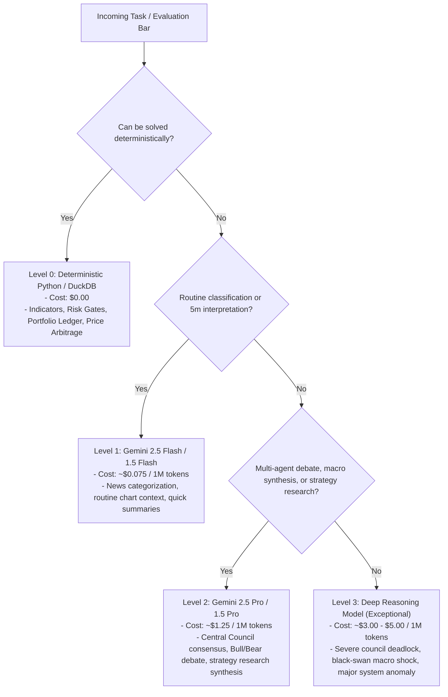

# Model Routing, Token Budgeting & Cost Optimization Architecture

## 1. Objective & Design Philosophy

Running multiple specialized AI agents across continuous 5-minute intraday market bars risks excessive token consumption and high API expenses if unmanaged.

To guarantee institutional efficiency and cost control, the system implements:
1. **Strict 4-Level Model Routing Hierarchy** (Deterministic first, LLM only when reasoning is required).
2. **Centralized Provider & Model Configuration** (Decoupled from application business logic).
3. **Hard Token & Financial Budgets Per Session** (Auto-circuit breaker).
4. **Structured JSON Communication** (Zero conversational filler).
5. **Deduplication & Short-term Semantic Caching** (Eliminates repeated queries for identical bars/news).

---

## 2. The 4-Level Model Routing Hierarchy



### Routing Assignment Matrix

| Subsystem / Task | Routing Level | Model Class | Rationale |
| :--- | :--- | :--- | :--- |
| **5m OHLCV Indicator Math** | Level 0 | Pure Python / NumPy / DuckDB | Financial arithmetic is exact and deterministic; LLM is inappropriate. |
| **Risk Constraints & Position Sizing** | Level 0 | Pure Python | Financial safety rules must be hardcoded and non-negotiable. |
| **Paper Ledger & Double-Entry Accounting** | Level 0 | Pure Python / DuckDB | Zero lookahead and mathematical balance invariance required. |
| **NSE/BSE Spread & Statutory Taxes** | Level 0 | Pure Python | Exact statutory formula calculations (STT, GST, Stamp Duty). |
| **Historical Backtest Simulation** | Level 0 | Pure Python / VectorBT pattern | Requires high-speed iteration over millions of bars. |
| **Routine News Categorization** | Level 1 | Gemini Flash (`gemini-2.5-flash`) | Low latency, low cost classification into structured schema. |
| **Routine Technical Chart Interpretation** | Level 1 | Gemini Flash (`gemini-2.5-flash`) | Contextualization of structured indicator outputs. |
| **Hourly Market Intelligence Summary** | Level 1 | Gemini Flash (`gemini-2.5-flash`) | Periodic digest of breadth, indices, and market tone. |
| **Central Council Synthesis & Debate** | Level 2 | Gemini Pro (`gemini-2.5-pro`) | Cross-examination of Bull vs. Bear theses and evidence weighting. |
| **Strategy Research Library Analysis** | Level 2 | Gemini Pro (`gemini-2.5-pro`) | Deconstructing complex Pine Script / quant research into testable models. |
| **Post-Session Performance Attribution** | Level 2 | Gemini Pro (`gemini-2.5-pro`) | Synthesizing trade logs, identifying decision weaknesses and biases. |
| **Exceptional Deadlock Resolution** | Level 3 | Gemini 2.5 Pro (High Reasoning) | Invoked only when Bull/Bear researchers irreconcilably diverge during high VIX. |

---

## 3. Cost Model & Financial Budget Controls

### Google Gemini Pricing Assumptions (Standard Rates)

| Model API Identifier | Input Cost (per 1M tokens) | Output Cost (per 1M tokens) | Context Caching Cost |
| :--- | :--- | :--- | :--- |
| `gemini-2.5-flash` | $0.075 | $0.30 | $0.01875 / 1M tokens |
| `gemini-2.5-pro` | $1.25 | $5.00 | $0.3125 / 1M tokens |

### Session Budget Configuration (`backend/phase6/cost.py` & Intraday Router)

```python
SESSION_COST_CONTROLS = {
    # Hard budget caps per active 09:15 - 15:30 IST session
    "max_daily_spend_usd": 0.50,          # Circuit breaker halts LLM calls if spend reaches $0.50
    "max_monthly_spend_usd": 10.00,        # Monthly ceiling for paper-trading research
    "max_calls_per_minute": 15,            # Rate limit guard
    "per_agent_token_budget_daily": {
        "market_intelligence": 150_000,   # ~6 hourly calls
        "technical_analysis": 250_000,    # Triggered only on active candle setups
        "news_sentiment": 100_000,        # Deduplicated event stream
        "central_council": 300_000,       # Hourly debates
        "strategy_research": 200_000,     # Offline batch research
        "learning_performance": 150_000,  # Post-market review
    }
}
```

---

## 4. Automatic Degraded-Mode Fallback Policy

If the daily token or dollar budget is exhausted:
1. **Safety First**: Deterministic trading logic continues running safely using Level 0 rules.
2. **Conservative Posture**: Central Council posture defaults to `HOLD / HIGH_RISK` or retains the last verified valid posture with decaying confidence.
3. **No Unapproved Swaps**: The system **never** silently switches to an unverified model.
4. **User Alert**: Dispatches a warning event to the dashboard logging `API_BUDGET_EXHAUSTED`.
5. **Risk Engine Unaffected**: Risk stops, profit targets, and 15:15 IST intraday square-offs execute normally with zero interruption.
