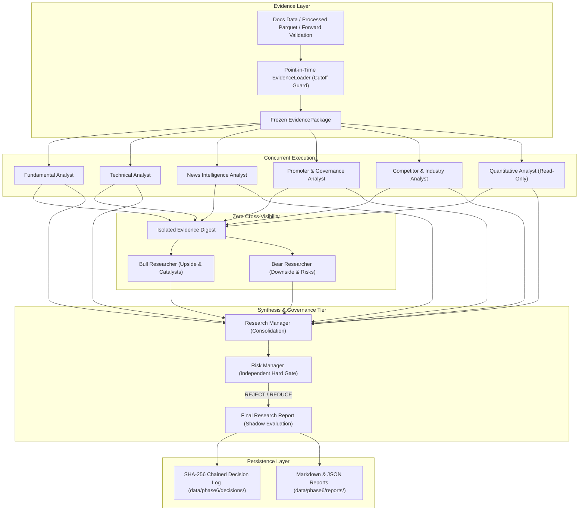

# BharatAlpha Phase 6 — Multi-Agent Intelligence Layer Architecture

## 1. Executive Summary

Phase 6 introduces a multi-agent investment research architecture inspired by the core engineering design of TauricResearch/TradingAgents, tailored to the Indian equity markets and BharatAlpha's existing quantitative infrastructure.

This initiative operates under **strict non-negotiable isolation rules**:
- The active prospective validation model (`5.3.0-pilot`, `237+17` features, 1D/5D/10D horizons) remains frozen and completely untouched.
- The multi-agent intelligence layer runs in an isolated namespace (`data/phase6/` and `backend/phase6/`).
- Decision logs and research outputs are stored separately with cryptographic SHA-256 provenance chains.

---

## 2. TauricResearch / TradingAgents Architectural Comparison

| Architecture Component | TauricResearch / TradingAgents Pattern | BharatAlpha Phase 6 Adaptation |
| :--- | :--- | :--- |
| **Orchestration** | LangGraph StateGraph with conditional edge routing | Deterministic, typed explicit StateMachine (`ShadowResearchGraph`) with strict DAG execution, checkpointing, and thread isolation |
| **State Contract** | TypedDict `AgentState` | Pydantic v2 `ResearchState` and frozen `EvidencePackage` with `extra="forbid"` |
| **Analyst Team** | Market, Fundamentals, News, Social Sentiment Analysts | 6 Specialist Analysts: Fundamental, Technical, News Intelligence, Promoter & Governance, Competitor & Industry, Quantitative |
| **Quantitative Integration**| Direct prompt generation | Deterministic `QuantitativeAnalystAgent` strictly reading frozen outputs (read-only); never retrains or alters the model |
| **Debate Layer** | Bull Researcher & Bear Researcher in multi-round debate | Independent Bull & Bear Researchers receiving identical, immutable evidence digests with zero cross-visibility before manager review |
| **Manager Layer** | Research Manager synthesizing debate | `ResearchManagerAgent` consolidating evidence, evaluating disagreements, and applying algorithmic guardrails |
| **Risk Gate** | Portfolio Manager & Risk Analysts approving trade orders | Independent `RiskManagerAgent` assessing 7 risk dimensions with hard veto authority (`REJECT` / `REDUCE`) overriding narrative conclusions |
| **Persistence** | Markdown memory log + SQLite checkpointing | SHA-256 hash-chained append-only decision log (`decisions.jsonl`) + JSON step checkpoints + immutable report snapshots |
| **Settlement** | `settle_all_pending()` on next market close | Chronological `settle()` using strictly subsequent NSE trading session opens and closes; never peeks into decision day |

---

## 3. Multi-Agent Topology & Information Flow

---

## 4. Key Guarantees & Safeguards

1. **Anti-Hallucination & Number Verification:**
   - Every numerical claim made by an agent must cite an explicit `evidence_id`.
   - The framework performs an automated scan of prose findings against allowed numbers from the evidence digest. Unmatched numbers are flagged, and agent confidence is penalised.
2. **Missing Information Discipline:**
   - Missing data items are explicitly tracked as `None` (never 0 sentinels).
   - Deterministic missing lists are merged automatically into agent outputs; LLMs cannot hide missing information.
3. **Point-in-Time (PIT) Integrity:**
   - The loader enforces `published_at <= data_cutoff_timestamp <= analysis_timestamp`.
   - Any record timestamped after the cutoff is strictly excluded and logged in `_notes`.
4. **Frozen Model Non-Interference:**
   - Built-in `frozen_guard.py` records SHA-256 hashes of all frozen production files before and after runs, ensuring zero mutations.
