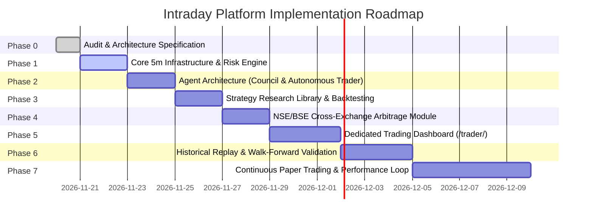

# Project Roadmap: AI Multi-Agent Intraday Trading Platform

---

## Phase Breakdown & Deliverables

### Phase 0: Audit & Architecture Specification (Complete)
- Perform full repository and open-source project audit.
- Establish architectural separation between BharatAlpha daily research and Intraday Trading Desk.
- Create core documentation: `ARCHITECTURE.md`, `AGENT_DESIGN.md`, `MODEL_ROUTING.md`, `STRATEGY_LIBRARY.md`, `TESTING.md`, `IMPLEMENTATION_STATUS.md`, `ROADMAP.md`.
- Establish feature branch: `feature/personal-ai-trading-desk`.

### Phase 1: Core 5-Minute Infrastructure & Risk Engine
- **Data Layer**: 5-minute OHLCV candle ingestion for NSE (`.NS`) and BSE (`.BO`) via `yfinance` & public adapters.
- **Validation Pipeline**: Monotonic timestamps in IST, gap detection, missing bar handling, OHLC invariants.
- **Feature Engine**: 5m VWAP (daily reset at 09:15 IST), EMA 9/21/50, RSI-14, MACD, ATR-14, CPR floor pivots.
- **Deterministic Risk Engine**: Hardcoded position sizing, daily loss limit (2.5%), exposure cap (80%), mandatory 15:15 IST square-off.
- **Paper Portfolio Ledger**: Double-entry accounting with exact statutory Indian friction deductions (STT, stamp duty, turnover fee, GST, slippage).
- **Deliverable**: Automated test suite passing in `tests/intraday/test_core_infrastructure.py`.

### Phase 2: Agent Architecture (Council & Autonomous Trader)
- **Specialized Agents**: Implement 10 agents with Pydantic v2 typed message contracts.
- **Layer A (Central Council)**: Multi-agent debate emitting one of 4 market postures (`BUY_BULLISH`, `SELL_BEARISH`, `NEUTRAL`, `HOLD_HIGH_RISK`).
- **Layer B (Autonomous Trader)**: Continuous 5m scanner making independent stock decisions without continuous council polling.
- **Event Bus**: Asynchronous event dispatch for market regime changes, high VIX alerts, and breaking news.
- **Model Router & Token Budgeting**: 4-tier model hierarchy, per-agent daily token limits, and deterministic degraded mode.
- **Deliverable**: Inter-agent message log and council debate simulation passing unit tests.

### Phase 3: Strategy Research Library & Backtesting Engine
- **Strategy Catalog**: Implement initial 4 strategies (VWAP Pullback, Opening Range Breakout, VectorBT EMA Cross, Cross-Exchange Stat-Arb).
- **Pine Script Workflow**: Standardized translator converting Pine Script logic to testable Python modules.
- **Deterministic Backtester**: Fast walk-forward validator with purged train/test splits, no lookahead, and transaction friction.
- **Deliverable**: Comparative benchmark report across historical sessions.

### Phase 4: NSE/BSE Cross-Exchange Arbitrage Module
- **Dual-Exchange Mapping**: ISIN-to-ticker mapping across NSE and BSE.
- **Executable Spread Calculation**: Real-time bid/ask comparison (not closing LTP) with full statutory friction deduction.
- **Paired Order Execution Simulator**: Models latency, partial fills, and unhedged leg risk management.
- **Compliance Rules**: Document exchange RMS and settlement restrictions.
- **Deliverable**: Cross-exchange opportunity scanner with historical simulation.

### Phase 5: Dedicated Trading Dashboard (`/trader/`)
- Build modern, responsive, standalone trader interface at `docs/trader/index.html` (accessible via GitHub Pages).
- **Sections**:
  1. Market Overview (Nifty, Bank Nifty, India VIX, Breadth, Council Posture).
  2. Stock Scanner (5m charts, VWAP, EMAs, active signals).
  3. Agent Council (Debate transcript, Bull vs. Bear arguments, consensus score).
  4. Cross-Exchange Opportunities (NSE vs. BSE executable spreads).
  5. Paper Portfolio (Equity curve, open positions, trade history, realized/unrealized P&L).
  6. Strategy Performance (Win rate, Sharpe, drawdown, expectancy).
  7. AI Cost & Token Monitor (Real-time token usage, per-agent spend, daily budget gauge).
- **Deliverable**: Fully functioning local preview and GitHub Pages deployment.

### Phase 6: Historical Replay & Walk-Forward Validation
- Historical session replay over diverse market regimes (trending, choppy, high-volatility event days).
- In-sample vs. out-of-sample performance evaluation.
- Controlled hypothesis testing for strategy improvement.
- **Deliverable**: Comprehensive validation report (`HISTORICAL_VALIDATION_REPORT.md`).

### Phase 7: Continuous Paper Trading & Live Data Integration
- Integrate live or simulated market feed during trading hours (09:15 - 15:30 IST).
- Run continuous autonomous paper trading loop.
- Daily automated performance attribution and journal generation.
- **Deliverable**: Stable, self-monitoring autonomous paper-trading platform.
