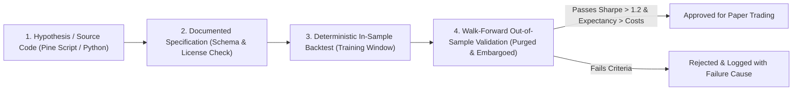

# Strategy Research Library & Quantitative Inventory

The Strategy Research Library serves as the institutional repository for all quantitative intraday hypotheses, imported open-source strategies, and public Pine Script models evaluated for Indian equities.

---

## 1. Strategy Onboarding & Verification Protocol

No strategy is permitted into live paper execution without passing the **4-Gate Quantitative Validation Pipeline**:

Every library entry must provide:
1. `strategy_id` & `strategy_name`
2. `source_origin` & `source_url`
3. `license_type` (MIT, Apache-2.0, Public Domain, etc.)
4. `market_applicability` (NSE Cash, BSE Cash, Liquid Top 50 / 200)
5. `execution_timeframe` (Default: 5-Minute Candles)
6. `required_indicators` (EMA, VWAP, RSI, ATR, etc.)
7. `entry_conditions` & `exit_conditions`
8. `known_limitations` (Whipsaws in choppy regimes, high turnover friction)
9. `historical_sharpe`, `profit_factor`, `win_rate`, `net_expectancy`
10. `validation_status` (`APPROVED_PAPER | IN_VALIDATION | REJECTED`)

---

## 2. Core Intraday Strategy Inventory

### Strategy ID: `STRAT-001-VWAP-PULLBACK-MOMENTUM`
- **Name**: Intraday VWAP Pullback with EMA Trend Confirmation
- **Origin**: Classical Institutional Execution / Adapted from *QuantConnect LEAN* & Pine Script Public Library
- **License**: MIT
- **Timeframe**: 5-Minute Candles (09:30 - 14:45 IST)
- **Applicability**: Nifty 50 & Liquid High-Beta Equities
- **Logic**:
  - **Entry (Long)**:
    1. Daily Market Posture from Council == `BUY / BULLISH`.
    2. Stock Price > Intraday VWAP.
    3. EMA 9 > EMA 21 > EMA 50 (Trend Alignment).
    4. Price pulls back towards VWAP / EMA 21 and prints a bullish rejection candle (hammer or bullish engulfing).
    5. Candle Volume > 1.2x of 20-period Volume SMA.
  - **Exit**:
    1. Target: 2.0x ATR-14 from entry price.
    2. Stop-Loss: Below recent 5m swing low or 1.0x ATR-14.
    3. Trailing Stop: Move to breakeven once price reaches 1.0x ATR gain.
    4. Session Square-Off: Force exit at 15:15 IST.
- **Validation Status**: `APPROVED_PAPER`

---

### Strategy ID: `STRAT-002-ORB-VOLUME-BREAKOUT`
- **Name**: Opening Range Breakout (ORB-15m) with Volume Spike Confirmation
- **Origin**: Toby Crabel / Open-source quantitative equity adaptations
- **License**: MIT
- **Timeframe**: 5-Minute Candles (Opening range: 09:15 - 09:30 IST; Entries: 09:30 - 11:30 IST)
- **Applicability**: Top 20 NSE Gainers/Losers with high pre-market volume
- **Logic**:
  - **Entry (Long)**:
    1. Identify high and low of the first 15 minutes of the session (09:15 to 09:30 IST).
    2. Opening range width must be <= 1.5x Daily ATR / 4 (not already over-extended).
    3. 5-minute candle closes above the 15m Opening Range High.
    4. Breakout candle volume >= 2.0x 20-period 5m volume SMA.
    5. RSI-14 between 55 and 72 (momentum intact without extreme exhaustion).
  - **Exit**:
    1. Target: 1.5x Opening Range Height added to breakout level.
    2. Stop-Loss: Back inside the Opening Range Midpoint.
    3. Time Stop: Exit if no momentum continuation within 6 candles (30 minutes).
- **Validation Status**: `IN_VALIDATION`

---

### Strategy ID: `STRAT-003-EMA-CROSS-MOMENTUM-VBT`
- **Name**: VectorBT Fast 9/21 EMA Dynamic Trend Filter
- **Origin**: *VectorBT* Open-source quantitative repository
- **License**: Apache-2.0
- **Timeframe**: 5-Minute Candles
- **Applicability**: Liquid Indian Mid-Caps & Large-Caps
- **Logic**:
  - **Entry (Long)**:
    1. Fast EMA 9 crosses above Slow EMA 21.
    2. Filter: 50 EMA is sloping upward (`EMA50[t] > EMA50[t-3]`).
    3. ADX-14 > 22 (identifies trending vs. choppy market).
  - **Exit**:
    1. EMA 9 crosses back below EMA 21.
    2. Trailing Stop at 1.5x ATR-14.
    3. Mandatory 15:15 IST square-off.
- **Validation Status**: `IN_VALIDATION`

---

### Strategy ID: `STRAT-004-NSE-BSE-CROSS-ARBITRAGE`
- **Name**: Dual-Exchange Stat-Arb with Statutory Friction Gate
- **Origin**: High-Frequency & Microstructure Literature / Institutional Indian Desk Practices
- **License**: Proprietary / Apache-2.0 Architecture
- **Timeframe**: Real-time tick & 5-minute candle executable spread
- **Applicability**: Dual-listed equities on NSE & BSE with identical ISIN
- **Logic**:
  - **Entry**:
    1. `Gross_Spread = NSE_Bid - BSE_Ask` (or `BSE_Bid - NSE_Ask`).
    2. Calculate total statutory deductions: Brokerage + STT + Turnover + Stamp Duty + GST + Slippage (5 bps/leg).
    3. `Net_Spread = Gross_Spread - Total_Friction`.
    4. Actionable trigger if `Net_Spread > 0.15%` and Bid/Ask depth on both legs >= intended lot size.
  - **Exit / Paired Fill**:
    1. Simultaneous execution of Leg 1 (Buy) and Leg 2 (Sell).
    2. If Leg 1 fills and Leg 2 does not fill within 2 seconds: immediate limit-reprice or market square-off of Leg 1 to prevent naked overnight exposure.
- **Validation Status**: `APPROVED_SIMULATION_ONLY` (Execution requires licensed broker API & compliance approval).

---

## 3. Pine Script Translation Standard

When converting public Pine Script strategies from TradingView:
1. Verify license allows academic / personal / open-source use.
2. Strip repaint-prone functions (`request.security()` with forward bars, `lookahead=barmerge.lookahead_on`).
3. Replace bar-close recalculation with deterministic closed-candle indexing: `close[1]` for decisions, executed at `open[0]` of the subsequent candle.
4. Integrate the statutory Indian transaction cost model into the backtester.
