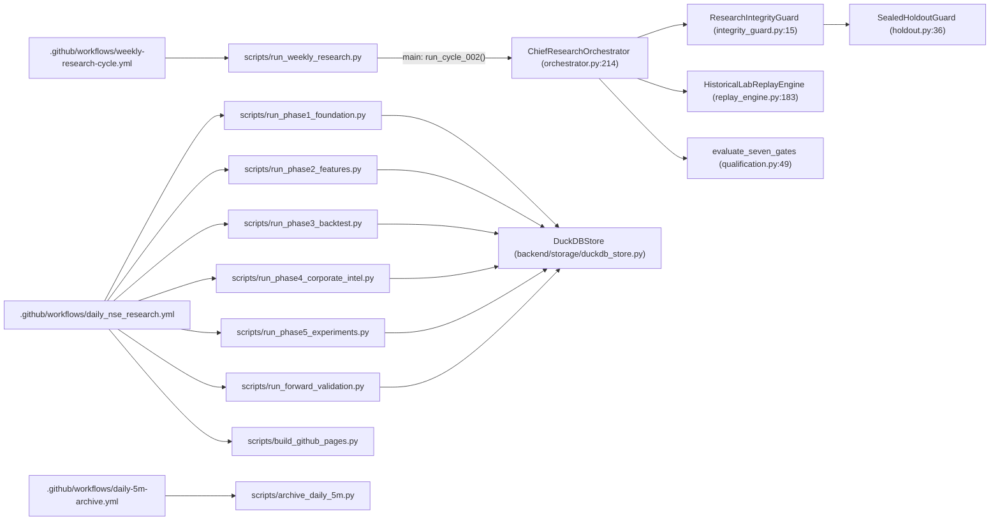

# BharatAlpha — Engineering Architecture & Research Integrity Reference

> **Verified Baseline**: `main` at commit `e083842` (Phase 11.3.1–11.3.6.1 merged via PR #9).
> **Verification Rule**: Every class, function, line range, and test count below was verified directly against `main` (`e083842`). Open pull requests ([PR #10](https://github.com/rammsec/indian-stock-ai-agent/pull/10), [PR #11](https://github.com/rammsec/indian-stock-ai-agent/pull/11), [PR #12](https://github.com/rammsec/indian-stock-ai-agent/pull/12)) are explicitly marked **Open / Unmerged**.

---

## Mandatory Change Governance Rule (Phase 11.4+)

Before modifying **any** function in this repository:
1. Inspect the function's full implementation, all relevant callers, downstream consumers, and existing tests.
2. Produce an exact **Change Proposal** identifying:
   - Target files, classes, functions, and line ranges
   - Expected behaviour and invariants preserved
   - Required regression tests and acceptance criteria
3. **Do not implement unapproved changes.**
4. Update `docs/engineering/ARCHITECTURE_AND_INTEGRITY.md` whenever an approved architectural change is merged.

---

## 1. Repository Architecture & Module Responsibilities

| Layer / Directory | Primary Responsibility | Key Modules |
| :--- | :--- | :--- |
| **`backend/`** | Daily NSE Bhavcopy/Delivery collection, DuckDB/Parquet storage (`DuckDBStore`), feature engineering (237+ features & leakage guard), walk-forward ML ensemble (`BharatAlphaQuantEnsemble`), Phase 5 news/forward validation, and Phase 6 shadow research. | [`backend/config.py`](../../backend/config.py), [`backend/data_engine.py`](../../backend/data_engine.py), [`backend/collectors/`](../../backend/collectors/), [`backend/features/`](../../backend/features/), [`backend/backtesting/`](../../backend/backtesting/), [`backend/prediction/`](../../backend/prediction/), [`backend/news_intel/`](../../backend/news_intel/), [`backend/storage/duckdb_store.py`](../../backend/storage/duckdb_store.py) |
| **`trader/data/`** | Intraday 5m & 1h NSE Parquet archive loading, resampling, and 15-check 1h provenance validation. | [`trader/data/loader.py`](../../trader/data/loader.py), [`trader/data/loader_1h.py`](../../trader/data/loader_1h.py), [`trader/data/provenance_1h.py`](../../trader/data/provenance_1h.py) |
| **`trader/strategies/`** | Deterministic intraday & delivery strategies, cost-aware wrappers, and walk-forward candle splitting. | [`trader/strategies/orb_breakout.py`](../../trader/strategies/orb_breakout.py), [`trader/strategies/vwap_pullback.py`](../../trader/strategies/vwap_pullback.py), [`trader/strategies/cost_aware_wrapper.py`](../../trader/strategies/cost_aware_wrapper.py), [`trader/strategies/validation.py`](../../trader/strategies/validation.py) |
| **`trader/lab/`** | Historical intraday replay engine, slippage sensitivity matrix, data quality analytics, and SQLite lab store. | [`trader/lab/data_service.py`](../../trader/lab/data_service.py), [`trader/lab/replay_engine.py`](../../trader/lab/replay_engine.py), [`trader/lab/database.py`](../../trader/lab/database.py) |
| **`trader/research/`** | Multi-agent research orchestration, 7-gate qualification, central integrity guard, and atomic holdout registry. | [`trader/research/orchestrator.py`](../../trader/research/orchestrator.py), [`trader/research/holdout.py`](../../trader/research/holdout.py), [`trader/research/integrity_guard.py`](../../trader/research/integrity_guard.py), [`trader/research/qualification.py`](../../trader/research/qualification.py), [`trader/research/agents.py`](../../trader/research/agents.py), [`trader/research/cycle004.py`](../../trader/research/cycle004.py) |
| **`scripts/`** | CLI entrypoints for daily Phases 1–5, 5m archiving, weekly research, and static dashboard builds. | [`scripts/run_phase1_foundation.py`](../../scripts/run_phase1_foundation.py) … [`scripts/run_phase5_experiments.py`](../../scripts/run_phase5_experiments.py), [`scripts/run_forward_validation.py`](../../scripts/run_forward_validation.py), [`scripts/archive_daily_5m.py`](../../scripts/archive_daily_5m.py), [`scripts/run_weekly_research.py`](../../scripts/run_weekly_research.py), [`scripts/build_github_pages.py`](../../scripts/build_github_pages.py) |
| **`data/lab/` & `docs/`** | Persisted research cycle reports (`cycle_002_report.json` … `cycle_004_report.json`), `sealed_holdout_registry.json`, GitHub Pages quant JSONs (`docs/data/`), and lab dashboard (`docs/lab/data/lab_index.json`). | [`data/lab/sealed_holdout_registry.json`](../../data/lab/sealed_holdout_registry.json), [`docs/lab/data/lab_index.json`](../../docs/lab/data/lab_index.json) |

---

## 2. Workflow → Script → Module → Function Dependency Map

Shared datasets & side-effect boundaries across workflows on `main`:
- `daily_nse_research.yml` writes `data/processed/`, `data/features/`, `data/predictions/`, `data/backtests/`, and `docs/data/`, then runs `pytest -v` (which mutates `docs/lab/data/lab_index.json` via `test_phase11_3_1_holdout_lifecycle.py`) and executes `git add ... docs/` + `git push origin main` (`daily_nse_research.yml:95-109`).
- `daily-5m-archive.yml` writes `data/intraday/` and `data/lab/daily_archive_health.json`, then pushes to `main` (`daily-5m-archive.yml:33-43`).
- `weekly-research-cycle.yml` runs `scripts/run_weekly_research.py` → `orch.run_cycle_002()`, which overwrites `data/lab/cycle_002_report.json`, `docs/lab/data/lab_index.json`, and mutates `data/lab/sealed_holdout_registry.json` via `record_exposure()`, then pushes to `main` (`weekly-research-cycle.yml:45-55`).
- *(Open PR #11 migrates `weekly-research-cycle.yml` + `run_weekly_research.py` to read-only; open PR #12 removes `git push` from `daily_nse_research.yml` and `daily-5m-archive.yml` and adds `concurrency:` groups.)*

---

## 3. End-to-End NSE Data → Stock Predictions Flow (`backend/` + `scripts/`)

1. **Phase 1 — Data Collection & Storage** ([`scripts/run_phase1_foundation.py:50`](../../scripts/run_phase1_foundation.py#L50)):
   - Calls `fetch_raw_company_data()` (`backend/data_engine.py`), `backend/collectors/`, `build_technical_snapshot()` (`backend/technical_engine.py`), and `run_full_stock_research()` (`backend/agents.py`).
   - Persists `data/processed/equities_daily.parquet` via `DuckDBStore` (`backend/storage/duckdb_store.py`).
2. **Phase 2 — Feature Engineering & Leakage Guard** ([`scripts/run_phase2_features.py:52`](../../scripts/run_phase2_features.py#L52)):
   - Reads `equities_daily.parquet`; calls `build_historical_feature_matrix()` (`backend/features/feature_engine.py`), `backend/features/leakage_guard.py`, and `evaluate_and_select_features()` (`backend/features/selector.py`).
   - Persists `data/features/daily_features.parquet` (`store.features_parquet`) and `data/features/feature_catalog.json`.
3. **Phase 3 — Walk-Forward Backtest & ML Prediction Generation** ([`scripts/run_phase3_backtest.py`](../../scripts/run_phase3_backtest.py)):
   - **Primary prediction generator**: reads `store.features_parquet`, `store.equities_parquet`, `store.regime_parquet`, and `store.quality_parquet`.
   - Calls `get_candidate_feature_columns()` (`backend/features/selector.py`), `run_walk_forward_backtest()` (`backend/backtesting/walk_forward.py`), `estimate_indian_roundtrip_cost()` (`backend/prediction/cost_model.py`), and `BharatAlphaQuantEnsemble` + `build_latest_prediction_records()` (`backend/prediction/ensemble_model.py`).
   - Persists `data/backtests/walk_forward_predictions.parquet`, `data/backtests/walk_forward_summary.json`, `data/predictions/prediction_log.parquet`, `data/predictions/latest_predictions.json`, `docs/data/latest_predictions.json`, and embeds `quantitative_prediction` into `docs/data/{SYMBOL}.json`.
4. **Phase 4 — Corporate & Institutional Enrichment (Downstream / Parallel)** ([`scripts/run_phase4_corporate_intel.py`](../../scripts/run_phase4_corporate_intel.py)):
   - Reads `equities_daily.parquet`, `quality.parquet`, `docs/data/regime.json`, and existing `docs/data/{SYM}.json`.
   - Calls `fetch_official_nse_bulk_and_block_deals()` and `build_corporate_intelligence_for_symbol()` (`backend/collectors/nse_corporate_collector.py`).
   - Persists `data/processed/nse_bulk_block_deals.parquet`, `data/processed/corporate_intelligence.parquet`, `docs/data/corporate_intel.json`, and enriches `docs/data/{SYMBOL}.json`. **Does not feed back into Phase 3 ML predictions.**
5. **Phase 5 & 5.3 — Multi-Horizon Experiments & Forward Validation (Downstream Evaluation Only)** ([`scripts/run_phase5_experiments.py`](../../scripts/run_phase5_experiments.py), [`scripts/run_forward_validation.py`](../../scripts/run_forward_validation.py)):
   - Phase 5 reads `daily_features.parquet`, `feature_catalog.json`, and `equities_daily.parquet`, writing `data/backtests/phase5_experiments.json` and `data/predictions/phase5_intelligence.json`. **Does not alter Phase 3 `latest_predictions.json`.**
   - Phase 5.3 (`evaluate_forward_outcomes()` and `build_forward_validation_payload()`, [`backend/news_intel/forward_validation.py`](../../backend/news_intel/forward_validation.py)) **only evaluates previously persisted immutable `ForwardPredictionSnapshot` records** by attaching realized market outcomes (`t+1` open → `t+H` close) after sessions mature; it never modifies or regenerates predictions.

---

## 4. Research Agent Inventory & Orchestration Map (`trader/research/`)

- **Orchestrator vs Agents**: [`ChiefResearchOrchestrator`](../../trader/research/orchestrator.py#L214) is the **only** orchestration class; it coordinates data loading, holdout reservation, replay execution, and report serialization.
- **Conceptual "Agent 1" Label**: There is **no** `Agent 1` class in `trader/research/agents.py`. Instead, [`trader/research/agents.py`](../../trader/research/agents.py) implements **8** agent classes (Agents 2–9), while `ChiefResearchOrchestrator` constructs an inline `AgentActivityReport(agent_name="Agent 1 — Chief Research Orchestrator", ...)` at [`orchestrator.py:447-459`](../../trader/research/orchestrator.py#L447-L459) during `CYCLE-002`.
- **Execution vs Reporting (`command_centre.active_agents`)**:
  - In `run_research_cycle()` (`CYCLE-002`), all 8 agent classes execute and 9 `AgentActivityReport` entries are emitted (`active_agents = len(agent_reports) = 9`, `line 532`).
  - In `run_cycle_003()` (`line 794`) and `run_cycle_004()` (`line 1344`), `command_centre.active_agents` is **hardcoded to `9`** as a reporting constant even though **only 4 agent classes execute** (`stat_agent`, `red_team`, `exec_agent`, `sq_agent`) and `agent_performance` only records `[exec_rep, sq_rep]`. `active_agents: 9` must **not** be interpreted as proof that 9 agents executed.

| Agent | Implementation & Line | Invoked In (`orchestrator.py`) | Inputs → Outputs & Decision Impact |
| :--- | :--- | :--- | :--- |
| **Agent 1 — Chief Research Orchestrator** | `ChiefResearchOrchestrator` ([`orchestrator.py:214`](../../trader/research/orchestrator.py#L214)); inline `AgentActivityReport` at [`lines 447-459`](../../trader/research/orchestrator.py#L447-L459) | `run_research_cycle()` (`CYCLE-002`) | Coordinates candidate execution and produces summary `AgentActivityReport`; **no self-approval authority**. |
| **Agent 2 — Market Data Intelligence** | `MarketDataIntelligenceAgent.audit_data()` ([`agents.py:35-52`](../../trader/research/agents.py#L35-L52)) | `run_research_cycle()` (`line 260`) | `dq_analytics`, `excluded_dates` → `AgentActivityReport` (`PASS`/`WARN`). Advisory only. |
| **Agent 3 — Quantitative Strategy Research** | `QuantitativeStrategyResearchAgent.propose_improvements()` ([`agents.py:55-97`](../../trader/research/agents.py#L55-L97)) | `run_research_cycle()` (`line 434`) | `leaderboard` → `(list[ResearchProposal], AgentActivityReport)`. Proposes bounded hypotheses. |
| **Agent 4 — Risk Management** | `RiskManagementAgent.review_risk()` ([`agents.py:100-116`](../../trader/research/agents.py#L100-L116)) | `run_research_cycle()` (`line 435`) | `leaderboard` → `AgentActivityReport` (`PASS`/`WARN` on drawdown > 10%). |
| **Agent 5 — Execution & Transaction Cost** | `ExecutionCostAgent.audit_costs()` ([`agents.py:119-166`](../../trader/research/agents.py#L119-L166)) | `run_research_cycle()` (`line 436`), `run_cycle_003()` (`line 774`), `run_cycle_004()` (`line 1300`) | `leaderboard`, `slippage_rows`, `orders` → `AgentActivityReport` (`PASS`/`FAIL` on ledger/fee mismatch > ₹1). |
| **Agent 6 — Statistical Validation** | `StatisticalValidationAgent.validate()` ([`agents.py:169-186`](../../trader/research/agents.py#L169-L186)) | All cycles (`lines 386, 729, 1101, 1164`) | `multi_day_metrics`, `walk_forward` → `("PASS" \| "FAIL" \| "INSUFFICIENT EVIDENCE", reason)`. **Directly gates Gate 7** (`qualification.py:152`). |
| **Agent 7 — AI Model & Decision Intelligence** | `AIModelDecisionAgent.audit_ai_vs_deterministic()` ([`agents.py:189-204`](../../trader/research/agents.py#L189-L204)) | `run_research_cycle()` (`line 437`) | `leaderboard` → `AgentActivityReport` (LLM vs deterministic attribution). |
| **Agent 8 — Software Quality & Reliability** | `SoftwareQualityAgent.review_system()` ([`agents.py:207-242`](../../trader/research/agents.py#L207-L242)) | `run_research_cycle()` (`line 440`), `run_cycle_003()` (`line 775`), `run_cycle_004()` (`line 1301`) | `test_report` → `AgentActivityReport` (`PASS` only if `executed > 0 and failed == 0`). |
| **Agent 9 — Strategy Challenger (Red Team)** | `StrategyChallengerRedTeamAgent.challenge()` ([`agents.py:245-273`](../../trader/research/agents.py#L245-L273)) | All cycles (`lines 387, 730, 1102, 1165`) | `multi_day_metrics`, `walk_forward` → `(bool, reason)` (rejects negative net/unseen, `< 20` trades, or 1-day profit dependence). **Directly gates Gate 7**. |

*Note*: `run_cycle_004()` (`orchestrator.py:1281, 1293`) invokes Agents 5, 6, 8, and 9 (not 2, 3, 4, 7), and writes `[exec_rep, sq_rep]` to `agent_performance`, while `command_centre.active_agents` is hardcoded to `9` (`line 1281`).

---

## 5. Research Orchestration Order & Deterministic Qualification (`run_cycle_004`)

In [`ChiefResearchOrchestrator.run_cycle_004()`](../../trader/research/orchestrator.py#L860-L1370):
1. **Stale Crash Recovery**: `holdout_guard.recover_stale_reservations("CYCLE-004")` (`line 881`).
2. **Split & Provenance**: `get_available_1h_dates()` (`line 884`, 60%/20%/20% split) → `validate_1h_provenance()` (`line 894`).
3. **Reserve & Guard**: `holdout_guard.seal_dates("CYCLE-004", unseen_1h_dates, ...)` (`line 897`) → `ResearchIntegrityGuard.validate()` (`line 901`).
4. **Abort / Pre-Access Release**: If neither `qualification_allowed` nor `exploratory_allowed` (or `allow_exploratory_on_blocked=False`), releases freshly sealed dates via `release_reservation()` (`line 930`) and returns `ABORTED_NO_EVALUATION` (`line 947`).
5. **Transition to In-Progress**: If `consumed_dates` is non-empty, calls `mark_evaluation_in_progress()` (`line 971`). If `ok=False`, aborts immediately before backtesting, attempts `release_reservation()` (`line 980`), and returns `ABORTED_TRANSITION_FAILED` (`line 1006`).
6. **Backtest & 7-Gate Evaluation**: Runs `HistoricalLabReplayEngine` (`lines 1049-1133`) and `run_cnc_swing_backtest()` (`lines 1140-1195`), calling `evaluate_seven_gates()` (`qualification.py:49`). On exception, `mark_evaluation_failed(..., data_accessed=True)` (`line 1198`) conservatively exposes accessed dates.
7. **Atomic Completion & Verification**: Calls `complete_evaluation()` (`line 1210`). If `ok=False`, inspects persisted registry (`lines 1226-1267`), invokes `mark_evaluation_failed()` only if owned accessed dates remain `SEALED`, and reports `COMPLETION_FAILED_RECOVERY_FAILED` if recovery fails.

*(Known bug on `main` at `orchestrator.py:1094, 1157`: `dr[v_end_1h:] or [dr[-1]]` falls back to the last validation day when `include_unseen_in_exploratory=False`; fixed in open [PR #10](https://github.com/rammsec/indian-stock-ai-agent/pull/10).)*

---

## 6. Holdout Registry Lifecycle & Concurrency Rules (`trader/research/holdout.py`)

| Method | Line Range | Lock Held? | Behaviour & Invariants |
| :--- | :--- | :--- | :--- |
| `_locked_registry()` | [`43-51`](../../trader/research/holdout.py#L43-L51) | N/A | `fcntl.flock(..., LOCK_EX)` on `sealed_holdout_registry.lock`. |
| `save_registry()` | [`109-118`](../../trader/research/holdout.py#L109-L118) | Caller-dependent | Writes `.tmp` and calls `os.replace(tmp_path, self.registry_path)`. |
| `seal_dates()` | [`128-200`](../../trader/research/holdout.py#L128-L200) | Yes | Rejects duplicates; atomically transitions `AVAILABLE -> SEALED` (`ACTIVE_RESERVATION`). |
| `record_exposure()` | [`202-318`](../../trader/research/holdout.py#L202-L318) | **Partial (Bug)** | Lines `276-294` (`sealed_exposures.append` + `save_registry`) execute **outside** `_locked_registry()`. Fixed in open [PR #11](https://github.com/rammsec/indian-stock-ai-agent/pull/11). |
| `retire_dates()` | [`427-456`](../../trader/research/holdout.py#L427-L456) | **No (Bug)** | Reads and writes without `_locked_registry()`. Fixed in open [PR #11](https://github.com/rammsec/indian-stock-ai-agent/pull/11). |
| `mark_evaluation_in_progress()` | [`458-500`](../../trader/research/holdout.py#L458-L500) | Yes | Verifies `SEALED`, `owning_cycle_id`, fingerprint; sets `EVALUATION_IN_PROGRESS` and `data_accessed=True`. |
| `complete_evaluation()` | [`502-952`](../../trader/research/holdout.py#L502-L952) | Yes | Checks `evaluation_history` first (`DUPLICATE_EVALUATION_ID_HISTORY` if `>1`, replay with `newly_exposed_dates=0` if identical, `EVALUATION_ID_CONFLICT` with `request_applied=False` if differing). Unseen IDs validate non-empty/non-duplicate/ownership/fingerprint/`EVALUATION_IN_PROGRESS`; failures after `data_accessed=True` conservatively expose owned dates as `FAILED_EVALUATION`. |
| `mark_evaluation_failed()` | [`954-1014`](../../trader/research/holdout.py#L954-L1014) | Yes | Transitions owned `SEALED` dates to `EXPOSED` (`FAILED_EVALUATION`) when `data_accessed=True`. |
| `recover_stale_reservations()` | [`1016-1044`](../../trader/research/holdout.py#L1016-L1044) | Yes | Transitions stale `EVALUATION_IN_PROGRESS` dates to `EXPOSED` (`FAILED_EVALUATION`). |
| `release_reservation()` | [`1046-1084`](../../trader/research/holdout.py#L1046-L1084) | Yes | Releases `SEALED` → `AVAILABLE` only for `owning_cycle_id` when `data_accessed` is False. |

---

## 7. Data Provenance & Integrity Requirements

- `validate_1h_provenance()` ([`trader/data/provenance_1h.py:22-265`](../../trader/data/provenance_1h.py#L22-L265)) runs 15 checks across `LAB_DEFAULT_UNIVERSE` `{SYMBOL}_1h.parquet` files; currently returns `PARTIALLY_VERIFIED` (`verified: False`) on the 240-session archive (`2025-11-21` → `2026-11-20`).
- `verify_dataset_provenance()` ([`orchestrator.py:62-146`](../../trader/research/orchestrator.py#L62-L146)) validates 5m Parquet archives.
- `ResearchIntegrityGuard.validate()` ([`integrity_guard.py:21-124`](../../trader/research/integrity_guard.py#L21-L124)) fails closed (`qualification_allowed=False`) unless `prov_status == "VERIFIED"`, `provenance_result["verified"] is True`, and all holdout/split/fingerprint checks pass.

---

## 8. Regression Test-Count Reconciliation (`tests/intraday/ tests/phase6/`)

Verified via `pytest tests/intraday/ tests/phase6/ --collect-only -q` and `git diff --stat` against `main` (`e083842`):

| Branch / PR | Base | Added Test File | Tests Added | Total Collected / Passed | Skips / Deselections |
| :--- | :--- | :--- | :---: | :---: | :---: |
| **`main`** (`e083842`) | — | — | — | **257** | 0 |
| **[PR #10](https://github.com/rammsec/indian-stock-ai-agent/pull/10)** (`ffcb88f`) | `e083842` | `tests/intraday/test_phase11_3_cycle005_audit.py` | +9 | **266** (`257 + 9`) | 0 |
| **[PR #11](https://github.com/rammsec/indian-stock-ai-agent/pull/11)** (`d94b3f5`) | `e083842` | `tests/intraday/test_phase11_3_6_holdout_locking_and_workflow.py` | +7 | **264** (`257 + 7`) | 0 |
| **[PR #12](https://github.com/rammsec/indian-stock-ai-agent/pull/12)** (`db3ea3b`) | `e083842` | `tests/intraday/test_phase11_3_7_workflow_and_registry_audit.py` | +5 | **262** (`257 + 5`) | 0 |

---

## 9. Test Side-Effect Inventory & Isolation Gaps

| Test File & Location | Side Effect on Tracked / Shared Paths | Current Isolation & Remaining Gap |
| :--- | :--- | :--- |
| [`tests/intraday/test_phase11_3_1_holdout_lifecycle.py:165-263`](../../tests/intraday/test_phase11_3_1_holdout_lifecycle.py#L165-L263) | Calls `orch.reassess_cycle_003_phase11_3_1()` with default output paths, overwriting `data/lab/cycle_003_phase11_3_1_reassessment.json`, `data/lab/provenance_report.json`, and `docs/lab/data/lab_index.json`. | Only `registry_path` is passed via `tmp_path`; report & index paths are not isolated. Mitigated in CI by PR #12 removing `git push` from `daily_nse_research.yml`. |
| [`tests/intraday/test_phase11_audit.py:37`](../../tests/intraday/test_phase11_audit.py#L37) | `test_archiver_completeness_protection` writes transient `data/intraday/*_NSE_5m.parquet` files when `archive_daily_5m` runs. | Uses `tmp_path` + `monkeypatch` partially, but leaves `*_NSE_5m.parquet` in `data/intraday/`. |
| [`tests/intraday/test_phase11_audit.py`](../../tests/intraday/test_phase11_audit.py) | `test_session_selection_reconciliation_parity` iterates ~112k rows via `df.iterrows()`, taking ~3.5 minutes on 1 CPU. | Causes `collect_dynamic_test_metrics(run_pytest=True)` + `run_cycle_005()` combined runs to exceed 600s timeouts. |
| Phase 11.3.2–11.3.7 test files | Use `tmp_path` for `registry_path` and `output_path`. | Fully isolated; zero writes to `data/lab/sealed_holdout_registry.json`. |

---

## 10. Remaining Unknowns & Risks

- **Open PRs**: PR #10 (`CYCLE-005` & `dr[-1]` fallback fix), PR #11 (`record_exposure`/`retire_dates` locking & weekly workflow migration), and PR #12 (daily workflow push-to-main removal & concurrency groups) are open and not yet merged into `main`.
- **Unverified Outside Scope**: `backend/phase6/` internal model weights and `scripts/run_phase1_foundation.py` live NSE scraping endpoints were inspected at entrypoints only and not executed against live NSE network endpoints in this pass.
