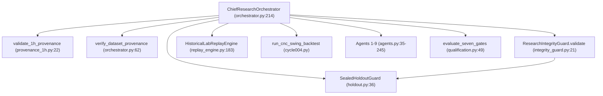
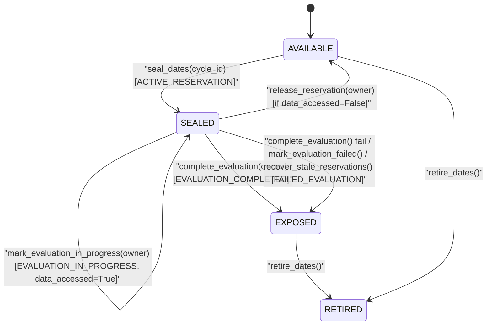

# BharatAlpha — Engineering Architecture & Research Integrity Reference

> **Baseline**: `main` at commit `e083842` (Phase 11.3.1–11.3.6.1 merged via PR #9).
> **Scope**: Documents the **actual existing implementation** on `main` with exact file paths, symbol names, and line numbers. Open pull requests ([PR #10](https://github.com/rammsec/indian-stock-ai-agent/pull/10), [PR #11](https://github.com/rammsec/indian-stock-ai-agent/pull/11), [PR #12](https://github.com/rammsec/indian-stock-ai-agent/pull/12)) are explicitly noted as **open / unmerged** where relevant.

---

## Mandatory Change Governance Rule (Phase 11.4+)

Before modifying **any** function in this repository:
1. Inspect the function's full implementation, all relevant callers, downstream consumers, and existing tests.
2. Produce an exact **Change Proposal** identifying:
   - Target files, classes, functions, and line ranges
   - Expected behaviour and invariants preserved
   - Required regression tests and acceptance criteria
3. **Do not implement unapproved changes.**
4. Update `docs/engineering/ARCHITECTURE_AND_INTEGRITY.md` whenever an approved architectural change is merged.

---

## 1. Repository Architecture & Module Responsibilities

| Layer / Directory | Primary Responsibility | Key Modules |
| :--- | :--- | :--- |
| **`backend/`** | Daily NSE Bhavcopy/Delivery collection, feature engineering, ML predictions, news/corporate intel, and static JSON generation for GitHub Pages (`docs/data/`). | [`backend/config.py`](../../backend/config.py), [`backend/data_engine.py`](../../backend/data_engine.py), [`backend/prediction/`](../../backend/prediction/), [`backend/news_intel/`](../../backend/news_intel/), [`backend/phase6/`](../../backend/phase6/) |
| **`trader/data/`** | Intraday 5m & 1h NSE Parquet archive loading, resampling, and strict 15-check 1h provenance validation. | [`trader/data/loader.py`](../../trader/data/loader.py), [`trader/data/loader_1h.py`](../../trader/data/loader_1h.py), [`trader/data/provenance_1h.py`](../../trader/data/provenance_1h.py) |
| **`trader/strategies/`** | Deterministic intraday & delivery strategies, cost-aware wrappers, and walk-forward candle splitting. | [`trader/strategies/orb_breakout.py`](../../trader/strategies/orb_breakout.py), [`trader/strategies/vwap_pullback.py`](../../trader/strategies/vwap_pullback.py), [`trader/strategies/cost_aware_wrapper.py`](../../trader/strategies/cost_aware_wrapper.py), [`trader/strategies/validation.py`](../../trader/strategies/validation.py) |
| **`trader/lab/`** | Historical intraday replay engine, slippage sensitivity matrix, data quality analytics, and SQLite lab store. | [`trader/lab/data_service.py`](../../trader/lab/data_service.py), [`trader/lab/replay_engine.py`](../../trader/lab/replay_engine.py), [`trader/lab/database.py`](../../trader/lab/database.py) |
| **`trader/research/`** | Multi-agent research orchestration, 7-gate qualification, central integrity guard, and atomic holdout registry. | [`trader/research/orchestrator.py`](../../trader/research/orchestrator.py), [`trader/research/holdout.py`](../../trader/research/holdout.py), [`trader/research/integrity_guard.py`](../../trader/research/integrity_guard.py), [`trader/research/qualification.py`](../../trader/research/qualification.py), [`trader/research/agents.py`](../../trader/research/agents.py), [`trader/research/cycle004.py`](../../trader/research/cycle004.py) |
| **`scripts/`** | CLI entrypoints for daily Phases 1–5, 5m archiving, weekly research, and static dashboard builds. | [`scripts/run_phase1_foundation.py`](../../scripts/run_phase1_foundation.py) … [`scripts/run_phase5_experiments.py`](../../scripts/run_phase5_experiments.py), [`scripts/archive_daily_5m.py`](../../scripts/archive_daily_5m.py), [`scripts/run_weekly_research.py`](../../scripts/run_weekly_research.py) |
| **`data/lab/` & `docs/lab/`** | Persisted research cycle reports (`cycle_002_report.json` … `cycle_004_report.json`), `sealed_holdout_registry.json`, and dashboard index `docs/lab/data/lab_index.json`. | [`data/lab/sealed_holdout_registry.json`](../../data/lab/sealed_holdout_registry.json), [`docs/lab/data/lab_index.json`](../../docs/lab/data/lab_index.json) |

---

## 2. Class & Function Dependency Mapping

Key call chains on `main`:
- `ChiefResearchOrchestrator.run_cycle_004()` ([`orchestrator.py:860`](../../trader/research/orchestrator.py#L860)):
  1. `SealedHoldoutGuard.recover_stale_reservations("CYCLE-004")` ([`holdout.py:1016`](../../trader/research/holdout.py#L1016))
  2. `get_available_1h_dates()` ([`loader_1h.py:74`](../../trader/data/loader_1h.py#L74)) → 60% / 20% / 20% split
  3. `validate_1h_provenance()` ([`provenance_1h.py:22`](../../trader/data/provenance_1h.py#L22))
  4. `SealedHoldoutGuard.seal_dates()` ([`holdout.py:128`](../../trader/research/holdout.py#L128))
  5. `ResearchIntegrityGuard.validate()` ([`integrity_guard.py:21`](../../trader/research/integrity_guard.py#L21)) → calls `SealedHoldoutGuard.validate_cycle_splits()` ([`holdout.py:330`](../../trader/research/holdout.py#L330))
  6. `SealedHoldoutGuard.mark_evaluation_in_progress()` ([`holdout.py:458`](../../trader/research/holdout.py#L458)) or `release_reservation()` ([`holdout.py:1046`](../../trader/research/holdout.py#L1046))
  7. `HistoricalLabReplayEngine.run_date_range()` & `run_cnc_swing_backtest()`
  8. `evaluate_seven_gates()` ([`qualification.py:49`](../../trader/research/qualification.py#L49))
  9. `SealedHoldoutGuard.complete_evaluation()` ([`holdout.py:502`](../../trader/research/holdout.py#L502)) or `mark_evaluation_failed()` ([`holdout.py:954`](../../trader/research/holdout.py#L954))

---

## 3. End-to-End Data Flow (NSE Data Collection → Predictions & Lab)

1. **Daily EOD / Pre-Market Quant Pipeline** (`.github/workflows/daily_nse_research.yml`):
   - `scripts/run_phase1_foundation.py` → collects NSE Bhavcopy, delivery %, indices, and market regime into `data/processed/`.
   - `scripts/run_phase2_features.py` → engineers technical/cross-sectional features into `data/features/`.
   - `scripts/run_phase3_backtest.py` → runs daily strategy backtests into `data/backtests/`.
   - `scripts/run_phase4_corporate_intel.py` & `scripts/run_phase5_experiments.py` → corporate intel, news intelligence, and ML predictions into `data/predictions/`.
   - `scripts/run_forward_validation.py` & `scripts/build_github_pages.py` → updates `docs/data/`.
2. **Intraday 5m Archive Pipeline** (`.github/workflows/daily-5m-archive.yml`):
   - `scripts/archive_daily_5m.py` → fetches 5m NSE candles for `LAB_DEFAULT_UNIVERSE` (`RELIANCE`, `TCS`, `BIRLACABLE`, `ITC`, `TATAELXSI`) into `data/intraday/` and updates `data/lab/daily_archive_health.json`.
3. **1-Hour Research Lab Pipeline** (`trader/research/orchestrator.py`):
   - Reads `{SYMBOL}_1h.parquet` via `get_available_1h_dates()` ([`loader_1h.py:74`](../../trader/data/loader_1h.py#L74)) and `load_1h_session_with_warmup()` ([`loader_1h.py:109`](../../trader/data/loader_1h.py#L109)).
   - Validates provenance via `validate_1h_provenance()` ([`provenance_1h.py:22`](../../trader/data/provenance_1h.py#L22)), enforces holdout ownership via `ResearchIntegrityGuard` & `SealedHoldoutGuard`, executes deterministic replay (`HistoricalLabReplayEngine`, ₹50,000 paper capital baseline), and evaluates the 7 gates.

---

## 4. Research Agent Orchestration & Decision-Making

Defined in [`trader/research/agents.py`](../../trader/research/agents.py):
- `MarketDataIntelligenceAgent` (`line 35`) — audits data completeness and excluded dates.
- `QuantitativeStrategyResearchAgent` (`line 55`) — proposes bounded parameter/filter hypotheses (`MAX_CANDIDATES_PER_CYCLE`, `MAX_TUNING_ROUNDS_PER_HYPOTHESIS`).
- `RiskManagementAgent` (`line 100`) — audits drawdown and risk limits.
- `ExecutionCostAgent` (`line 119`) — reconciles gross PnL, brokerage, statutory taxes, and 5/10/20/30 bps slippage (`abs((init_cap + gross_pnl - fees) - final_eq) <= 1.0`).
- `StatisticalValidationAgent` (`line 169`) — enforces `sessions >= 60`, `trades >= 30`, and positive overall + unseen returns.
- `AIModelDecisionAgent` (`line 189`) — tracks genuine LLM vs deterministic runs ($0.00 unapproved paid API calls).
- `SoftwareQualityAgent` (`line 207`) — verifies `collect_dynamic_test_metrics()` execution counts (`orchestrator.py:149`).
- `StrategyChallengerRedTeamAgent` (`line 245`) — rejects non-positive net/unseen returns, `< 20` trades, or single-day profit concentration.

Final qualification is decided deterministically by `evaluate_seven_gates()` ([`qualification.py:49-193`](../../trader/research/qualification.py#L49-L193)):
- Gate 1 (`Data & Holdout Integrity`) takes strict precedence: failure yields `BLOCKED_INTEGRITY` or `INVALIDATED`.
- Only `7/7` passing gates yield `QUALIFIED`.

---

## 5. Training, Validation & Unseen-Data Separation

- Chronological split in `run_research_cycle()` (`orchestrator.py:313-316`), `run_cycle_003()` (`line 670`), and `run_cycle_004()` (`lines 886-891`):
  - `train`: first 60% (`[:t_end]`)
  - `validation`: next 20% (`[t_end:v_end]`)
  - `unseen_test`: final 20% (`[v_end:]`)
- `SealedHoldoutGuard.validate_cycle_splits()` ([`holdout.py:330-425`](../../trader/research/holdout.py#L330-L425)) rejects any overlap between splits, any non-`AVAILABLE` date in `train`/`validation`, any `EXPOSED`/`RETIRED` date in `unseen_dates`, any `SEALED` date owned by another cycle, or any `dataset_fingerprint` mismatch.
- **Known Bug on `main`**: In `run_cycle_004()` ([`orchestrator.py:1105, 1168`](../../trader/research/orchestrator.py#L1105)), `unseen_slice = dr[v_end_1h:] or [dr[-1]]` falls back to the final validation day `[dr[-1]]` when `eval_type == "EXPLORATORY_TRAIN_VAL_ONLY"` (`eval_dates` has length `v_end_1h`). Fixed in open [PR #10](https://github.com/rammsec/indian-stock-ai-agent/pull/10).

---

## 6. Holdout Registry Lifecycle & Concurrency Rules

Managed by `SealedHoldoutGuard` ([`trader/research/holdout.py:36`](../../trader/research/holdout.py#L36)) over `data/lab/sealed_holdout_registry.json`:

- **Locking**: `_locked_registry()` ([`holdout.py:43-51`](../../trader/research/holdout.py#L43-L51)) uses `fcntl.flock(..., fcntl.LOCK_EX)` on `sealed_holdout_registry.lock`, and `save_registry()` ([`holdout.py:109-118`](../../trader/research/holdout.py#L109-L118)) writes a `.tmp` file and atomically replaces via `os.replace()`.
- **Idempotency & Conflict Rules** (`complete_evaluation()`, [`holdout.py:502-952`](../../trader/research/holdout.py#L502-L952)):
  - Under `_locked_registry()`, looks up `evaluation_history` for `evaluation_id` *before* empty/duplicate date validation.
  - `> 1` matching records → fails closed with `DUPLICATE_EVALUATION_ID_HISTORY`.
  - `1` matching record with identical `(cycle_id, evaluation_type, sorted(consumed_dates), dataset_fingerprint, sorted(strategy_ids))` → replays original result with `idempotent_replay=True`, `newly_exposed_dates=0`, no registry mutation.
  - `1` matching record with differing identity → rejects with `EVALUATION_ID_CONFLICT`, `request_applied=False`, `newly_exposed_dates=0`, reporting the original persisted `holdout_consumed`/`holdout_state`.
- **Known Concurrency Gaps on `main`**:
  - `record_exposure()` ([`holdout.py:276-294`](../../trader/research/holdout.py#L276-L294)) appends `sealed_exposures` and calls `save_registry()` outside `_locked_registry()`.
  - `retire_dates()` ([`holdout.py:427-456`](../../trader/research/holdout.py#L427-L456)) does not acquire `_locked_registry()`.
  - Fixed in open [PR #11](https://github.com/rammsec/indian-stock-ai-agent/pull/11).

---

## 7. Data Provenance & Integrity Requirements

- **1h Provenance** (`validate_1h_provenance()`, [`provenance_1h.py:22-265`](../../trader/data/provenance_1h.py#L22-L265)):
  - Verifies file existence, SHA-256 fingerprint, `Asia/Kolkata` timezone, zero duplicate timestamps, OHLC consistency (`high >= max(open, close)`, `low <= min(open, close)`, positive prices), non-negative volume, session boundaries (`09:15–15:15 IST`), missing NSE trading calendar intervals, and `>= 60` sessions.
  - Currently returns `PARTIALLY_VERIFIED` (`verified: False`) on the 240-session 1h archive (`2025-11-21` → `2026-11-20`).
- **5m Provenance** (`verify_dataset_provenance()`, [`orchestrator.py:62-146`](../../trader/research/orchestrator.py#L62-L146)): verifies completeness, duplicates, and SHA-256 checksums across 5m Parquet files.
- **Central Gate** (`ResearchIntegrityGuard.validate()`, [`integrity_guard.py:21-124`](../../trader/research/integrity_guard.py#L21-L124)): fails closed unless `prov_status == "VERIFIED"` and `provenance_result.get("verified") is True` and all holdout/split/fingerprint checks pass.

---

## 8. Daily, Weekly & Intraday Workflow Dependencies

| Workflow | Schedule / Trigger | Main Branch Behaviour (`e083842`) | Open PR Status |
| :--- | :--- | :--- | :--- |
| [`.github/workflows/intraday-lab-tests.yml`](../../.github/workflows/intraday-lab-tests.yml) | Push/PR to `main` | Runs `pytest tests/intraday/ tests/phase6/ -v --tb=short`; does not push | [PR #12](https://github.com/rammsec/indian-stock-ai-agent/pull/12) adds explicit `contents: read` |
| [`.github/workflows/weekly-research-cycle.yml`](../../.github/workflows/weekly-research-cycle.yml) | Cron `0 12 * * 0` (Sun 17:30 IST) | Runs `scripts/run_weekly_research.py` (`CYCLE-002` + `record_exposure`), commits `data/lab/` & `docs/lab/data/` and pushes to `main` | [PR #11](https://github.com/rammsec/indian-stock-ai-agent/pull/11) migrates to read-only audit + artifact upload |
| [`.github/workflows/daily_nse_research.yml`](../../.github/workflows/daily_nse_research.yml) | Cron `30 3` & `0 13 * * 1-5` | Runs Phases 1–5 + `pytest -v`, then `git push origin main` (including `docs/`) | [PR #12](https://github.com/rammsec/indian-stock-ai-agent/pull/12) restricts to `contents: read`, adds `concurrency:`, uploads artifacts |
| [`.github/workflows/daily-5m-archive.yml`](../../.github/workflows/daily-5m-archive.yml) | Cron `20 10 * * 1-5` | Runs `archive_daily_5m.py` and `git push` to `main` | [PR #12](https://github.com/rammsec/indian-stock-ai-agent/pull/12) restricts to `contents: read`, adds `concurrency:`, uploads artifacts |

---

## 9. Test Coverage & Known Test Side Effects

- **Suite**: `pytest tests/intraday/ tests/phase6/ -q` (**257 passed** on `main` at `e083842` / `4b01750`; **262–266 passed** across open PRs #10, #11, #12).
- **Phase 11.3 Lifecycle Tests**: `tests/intraday/test_phase11_3_1_holdout_lifecycle.py` through `test_phase11_3_6_idempotency_edge_cases.py` (and `test_phase11_3_gate_enforcement.py`).
- **Known Test Side Effects**:
  - `test_phase11_3_1_holdout_lifecycle.py` calls `orch.reassess_cycle_003_phase11_3_1()`, which writes to production paths `data/lab/cycle_003_phase11_3_1_reassessment.json`, `data/lab/provenance_report.json`, and `docs/lab/data/lab_index.json`.
  - `test_phase11_audit.py::test_session_selection_reconciliation_parity` takes ~3.5 minutes on a single CPU due to `df.iterrows()` across ~112k rows, and `test_archiver_completeness_protection` writes transient `data/intraday/*_NSE_5m.parquet` files.

---

## 10. Previously Identified Bugs, Fixes & Unresolved Risks

| ID | Issue | Status |
| :--- | :--- | :--- |
| Phase 11.3.1–11.3.3 | Non-atomic `complete_evaluation()`, misleading `EXPOSED` history on failure, uncleaned failed `mark_evaluation_in_progress()` | **Fixed on `main`** (PR #9, `e083842`) |
| Phase 11.3.4 | Failed completion after `data_accessed=True` left owned dates `SEALED` | **Fixed on `main`** (PR #9, `e083842`) |
| Phase 11.3.5–11.3.6.1 | Non-idempotent `complete_evaluation()`, duplicate history, malformed retry bypass, `newly_exposed_dates` on replay | **Fixed on `main`** (PR #9, `e083842`) |
| CYCLE-005 & `dr[-1]` fallback | `CYCLE-005` holdout reporting, `NOT_RUN` test evidence, `dr[v_end_1h:] or [dr[-1]]` validation fallback, `recovery_failed` check | **Open in [PR #10](https://github.com/rammsec/indian-stock-ai-agent/pull/10)** |
| `holdout.py` locking & weekly CI | `record_exposure()`/`retire_dates()` outside `_locked_registry()`, weekly `CYCLE-002` push to `main` | **Open in [PR #11](https://github.com/rammsec/indian-stock-ai-agent/pull/11)** |
| Daily CI direct pushes to `main` | `daily_nse_research.yml` & `daily-5m-archive.yml` `git push` to `main` + missing `concurrency:` groups | **Open in [PR #12](https://github.com/rammsec/indian-stock-ai-agent/pull/12)** |
| Test isolation side effects | `test_phase11_3_1_holdout_lifecycle.py` mutating `docs/lab/data/lab_index.json` locally | **Unresolved (Low)** — mitigated in CI by PR #12 removing `git push` |
